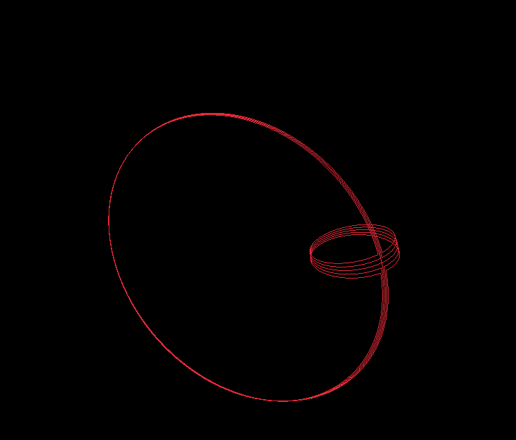
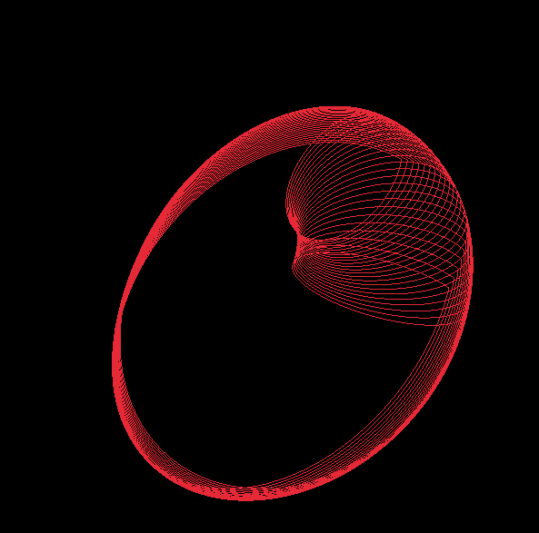
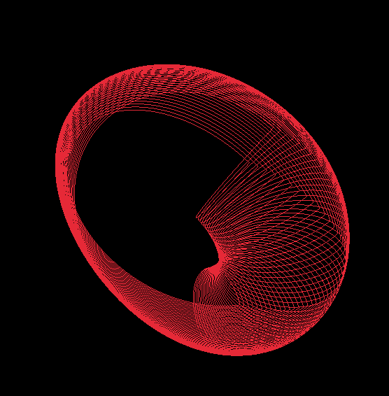
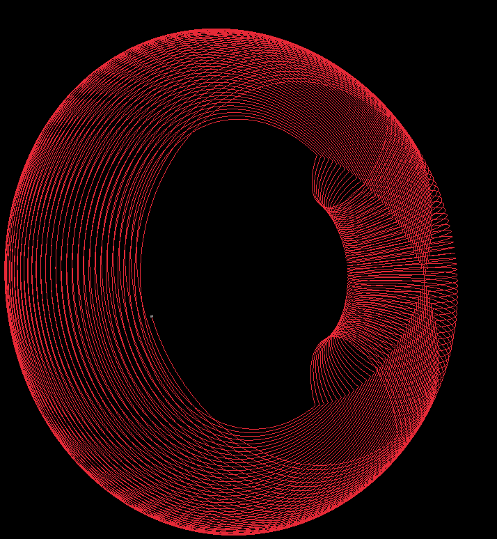

# Parametric Surface Visualiser

A real-time 3D path is traced along the parametric surface specified by the user, over time the surface comes to life.

## Screenshots

Here is an example for the parametrisation

x(t,l) = (2+cos(l))*cos(t)

y(t,l) = (2+cos(l))*sin(t)

z(t,l) = sin(l)*cos(t/2)

t ∈ [0,6.283185]

l ∈ [0,6.283185]

<p align="center">
  
  
</p>

<p align="center">
  
  
</p>

## Dependencies

- CMake
- C++ compiler supporting C++20
- [Raylib](https://www.raylib.com/)
- [GLM](https://github.com/g-truc/glm)
- [muParser](https://beltoforion.de/en/muparser/)

## Compilation

Clone the repository:

```bash
git clone https://github.com/sinan-steinhardt/parametric-surface-visualiser.git
cd parametric-surface-visualiser
```

Build the project:

```bash
cmake -S . -B build
cmake --build build -j$(nproc)
```

## License

MIT License
